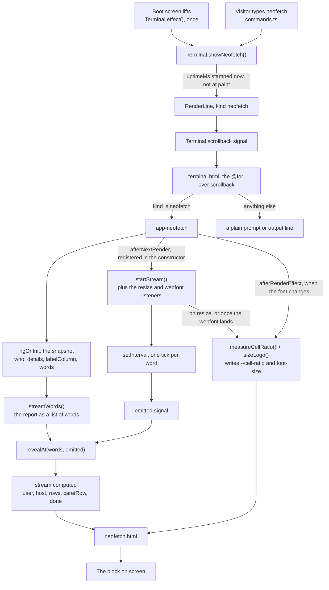
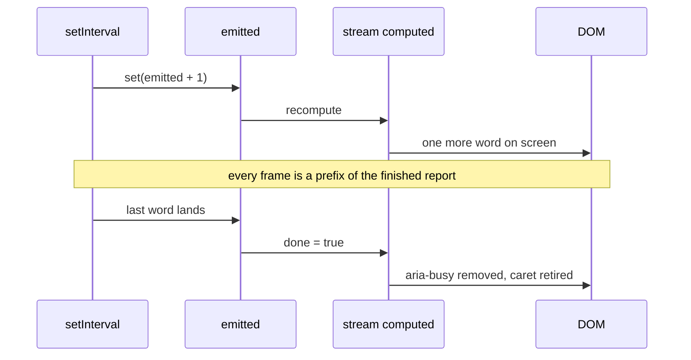

# The `neofetch` block

How the report is produced and rendered: what asks for it, what decides its shape, and
what makes it arrive a word at a time.

The block is the one piece of the terminal that is not a string on screen. Everything else
in the scrollback is text with a prompt in front of it; this is a logo and a two-column
report, so it is a component.

## The pipeline

## What happens on a single tick

The timer touches nothing but the counter. What is on screen is a pure function of the
planned words and how many have landed, which is why a slow frame skips a beat rather than
corrupting a line.

## Two rendering mechanisms, deliberately different

**The text is signal-driven.** `streamWords()` plans the report once, `emitted` counts up,
`revealAt()` projects it. Nothing about the DOM is read.

**The logo is measured.** `measureCellRatio()` asks the browser how wide one cell of
whichever face is actually drawn is, and `sizeLogo()` then asks CSS what font size that implies
and writes back the largest size at or below it whose glyph cell is a whole number of device
pixels. Both have to run after render because they need a real element to measure, and both
re-run on resize, when the webfont finishes loading, and when the `font` command changes the
family.

They stay separate because they answer to different things: the text answers to the stream
clock, the logo to the viewport.

The logo is not streamed. It is the block's shape, and revealing it gradually would push the
finished lines down the screen as the art grew - the opposite of what output does.

## Why a word, not a character

Two reasons, both practical.

Words vary in length, so a fixed interval still lays characters down at an irregular rate -
which is what streamed output looks like - while the schedule stays deterministic enough to
test.

And the report is a grid, not a string. A label and its value live in different cells, so a
single character has no one place to land, but a word does. A word is the smallest unit that
still has an obvious home.

## The one promise

> What is on screen is always a prefix of the finished report.

Nothing is rewritten, nothing is reordered, no word moves once it has landed. `revealAt()`
holds this as a pure function, and it is asserted both ways: in the unit tests over every
count, and in the browser by sampling a real load and checking each frame against the next.

## Files

Paths are from the repository root. The implementation lives under `src/app/`.

| File                                      | Responsibility                                                       |
| ----------------------------------------- | -------------------------------------------------------------------- |
| `src/app/terminal/line.ts`                | `LineKind` gains `neofetch`; `RenderLine.uptimeMs` carries the stamp |
| `src/app/terminal/commands.ts`            | the `neofetch` and `font` commands, `showNeofetch()` on the context  |
| `src/app/terminal/terminal.ts`            | `showNeofetch()`, the MOTD effect, `commandCount`, the `theme` input |
| `src/app/terminal/terminal.html`          | branches the scrollback loop onto `<app-neofetch>`                   |
| `src/app/terminal/terminal.config.ts`     | `reveal.msPerToken`, `fonts`, `font.advanceRatio`, `system.*`        |
| `src/app/terminal/neofetch/neofetch.ts`   | planning, streaming, measuring: everything above                     |
| `src/app/terminal/neofetch/neofetch.html` | binds the reveal to the DOM                                          |
| `src/app/terminal/neofetch/neofetch.scss` | art sizing, the reserved label column, the cursor                    |

## Settings

| Setting    | Where                          | Value                               | What it controls                                                                                                    |
| ---------- | ------------------------------ | ----------------------------------- | ------------------------------------------------------------------------------------------------------------------- |
| Cadence    | `config.reveal.msPerToken`     | 38                                  | one word per tick; the report is ~27 words, so ~1s                                                                  |
| Cell ratio | measured, `measureCellRatio()` | 0.6 for the bundled face            | the art's width and the whole-pixel snap. Config's `font.advanceRatio` stands in only where nothing can be measured |
| Art width  | `neofetch.scss`                | `100vw * 0.6 / (42 * --cell-ratio)` | about three quarters of a phone's text column, whatever face is drawn                                               |
| Text cap   | `neofetch.scss`                | `--text-terminal`                   | the art never outgrows the terminal's own text                                                                      |

`REVEAL_TIMING` wraps the cadence and `REDUCED_MOTION` the platform preference, as injection
tokens, so tests can drive either without waiting on real time or faking a media query.

## Changing the font

`font` (see `commands.ts`) swaps `--font-terminal`, which is the family the art is drawn in as
well as the text. That reaches this block in three places, and only the first is cosmetic:

- the report's `Font` row names the family in force when the block was printed, and freezes
  there - a block printed under one font keeps saying so even though its art restyles live,
  exactly as it keeps its `Theme` row while the colours change around it;
- `measureCellRatio()` re-measures, because the cell width is a property of the face, and
- `--cell-ratio` is republished so the CSS sizing formula produces the same _width_ rather than
  the same _size_.

The third is why the formula looks odd. Measured advances on Linux Chromium:

| family                    | `M`       | `█`       | `║`       | `❯` |
| ------------------------- | --------- | --------- | --------- | --- |
| the bundled face          | 0.6       | 0.6       | 0.6       | 0.6 |
| a lone `ui-monospace`     | **0.889** | **0.709** | **0.709** | 0.6 |
| `ui-monospace, monospace` | 0.6       | 0.6       | 0.6       | 0.6 |
| `monospace`               | 0.6       | 0.6       | 0.6       | 0.6 |

Read the middle row as the bug this whole file exists to avoid: a lone generic family resolves
to a face that disagrees with itself about how wide a cell is, so every column right of a
substituted glyph sits at a different pitch and the block letters lean. The `monospace` fallback
in the second stack is what keeps that from happening, which is why `font --list` offers stacks
rather than bare families.

Because the advance is measured rather than assumed, a face that genuinely is wider gets a
smaller font size and the same art width: forcing `--cell-ratio` to 0.6, 0.75 and 0.9 produced
9.29px, 7.43px and 6.19px - and 267.4px of art in all three cases.

### Why the fit is measured, not derived

The sizing above is a derivation: _48 columns × 0.6em × this size is 69% of the viewport, so it
fits_. That only holds if the browser renders the font size it was asked for, and several ordinary
things override it - a minimum font size, Android's font-scale setting, a face substituted for the
box-drawing range that is wider than the one measured, a `calc()` the browser declines to parse.
Each of those leaves 48 columns simply wider than the box, and nothing in the derivation notices.

So `sizeLogo()` finishes by measuring: it sets the size, compares the element's `scrollWidth` to
its `clientWidth`, and shrinks until that comparison stops being true. Width is proportional to
size, so one pass normally lands exactly; the loop is for the rounding tie. It stops rather than
shrinking to nothing if no whole-pixel size is left below the current one - art that is a little
too wide beats art that vanished.

Verified by squeezing the layout to 168px wide and firing a resize: the art went from 255.6px to
159.8px and the overflow stopped.

### The scroller cannot pan sideways either

`overflow-y: auto` on the scroll container forces its `overflow-x` to compute to `auto` too, so one
over-wide child turns the whole terminal into a surface that pans left and right on a phone. The
scroller now sets `overflow-x: hidden` as well. That is a backstop, not the fix: the measured fit
above is what keeps the art inside, and clipping would hide a bug rather than cause one.

### The list output has a width budget too

`font --list` rows are bounded by `LINE_BUDGET` (31 characters), which is what a 320px screen fits:
288px of content at a nine-pixel cell is 32 characters, and one is held in reserve.

The reason it is a budget rather than a style choice: `printOutput` commits text to the scrollback,
and committed text cannot reflow when the window changes. The first version padded a description
column into every row and produced 97-character lines, which a phone folded into eight ragged
fragments starting at the margin - a table with its columns gone. So the description column is
dropped, the caveat became one shared line, and `commands.spec.ts` asserts the budget on every line
the command can produce.

One deliberate exception: a name the visitor typed is echoed back in full even when that breaks the
budget. Truncating it to stay inside 31 characters would report something they did not type.

## Details that only exist because the text grows

**The label column is reserved.** The grid sizes that column to its content, so left alone it
grows every time a longer label lands - and every value already on screen slides right behind
it. `widestLabel()` measures the finished report, `ngOnInit` turns that into `labelColumn`, and
the template binds it to `--label-column` before the first word is typed.

**The cursor is a pseudo-element.** It marks whichever row is current through
`[class.caret-here]` rather than a child element. An element inserted beside an interpolation
drags template whitespace in with it, and the report would end up holding spaces it never
typed. The colon is markup for the related reason: a `dt::after` would put the cursor between
a label and its colon.

**The cursor retires.** It marks "more is coming". One that outlives the stream reads as a
prompt waiting for input, and this block is output.

## Accessibility

The block carries `aria-busy` while the report is arriving and nothing after, and
deliberately **no live region**: a live region would announce every word as it landed, so a
screen reader would hear "OS", "mpdev", "web", "terminal" as separate utterances instead of
one finished line. With `prefers-reduced-motion: reduce` the whole report is present
immediately - the same information, without the wait.

## Verified

Both are checked in the browser, not only in unit tests.

The streaming, sampled from a real page load at 390px: multiple distinct frames, monotonic row
growth, every frame a prefix of the finished report, the cursor riding the newest word and
retiring at completion, the value column holding one left edge throughout, and `clear`
mid-typing leaving no orphaned timer behind.

The font, driven through the command at 390px and 320px: the `calc()` resolves rather than
falling back to the text size, the art fits its column, the cell lands on a whole device pixel,
every glyph keeps one advance (no per-glyph substitution), `--cell-ratio` scales the size so the
art width is unchanged, an unknown name or option is refused with `✗` and changes nothing, a
report keeps the font it was printed in, `--save` survives a reload, and an id left over from an
older build falls back to the default rather than wedging the boot screen.

Width, after the wrapping bug: every line `font --list` prints is one visual line at 320px and at
390px (counted from paragraph height over line-height, because counting range rects lies - a
leading run of spaces gets its own rect on a single-line paragraph), and no container on the page
can pan sideways at 280, 320, 360, 390 or 740px.

## Known seam: the view does not follow the growth

The terminal pins the view to the bottom in an `afterRenderEffect` that reads `scrollback()`,
`input()` and `viewport.height()`. None of those change while a report is typing - `emitted`
belongs to the child view - so the pin runs once when the block is created, against the height
it had at that moment, and never again.

This is new with the stream. Everything else in the scrollback changes height by _appending
an entry_, which is a `scrollback()` change, so the pin re-runs against the new total. The
report is the first thing here that changes size while the list stays exactly as long: before
it typed a word at a time, the block was already complete the moment it was added.

`font` reaches the same cause by a different route. A face with a different cell width re-fits
the art, which changes the block's height with no scrollback edit at all, so the pin has the
same reason to miss it. On this machine the three offered faces all measure 0.6em, so the
height does not in fact move and the drift is not visible - which is a fact about Linux
Chromium, not a guarantee. Two possible triggers, one cause: the pin follows the list rather
than the pixels.

At 390x844 the finished block still fits, so this is invisible. At 390x320 - a phone in
landscape, or one with the keyboard open - it is not:

| measured after the greeting finishes | value                                  |
| ------------------------------------ | -------------------------------------- |
| scroller `scrollTop`                 | 0, i.e. never moved                    |
| content height vs visible height     | 419px vs 266px                         |
| left below the fold                  | 153px                                  |
| live prompt line's bottom            | 457px, against a visible edge at 320px |

So the report types itself in, finishes, and leaves the line you are meant to type on off
screen. Typing still works - the input is captured regardless of scroll position - but the
caret is not visible.

This is a _vertical_ seam. The `overflow-x-hidden` backstop described above governs the other
axis and does nothing here: the content is not too wide, it is below the fold and nothing scrolls
to it.

The fix is to make the follow respond to growth rather than to new lines only. A
`ResizeObserver` on the scroller's content is the direct version of that; it also covers
anything else that changes height without touching the scrollback, such as the logo resizing
on rotation.
