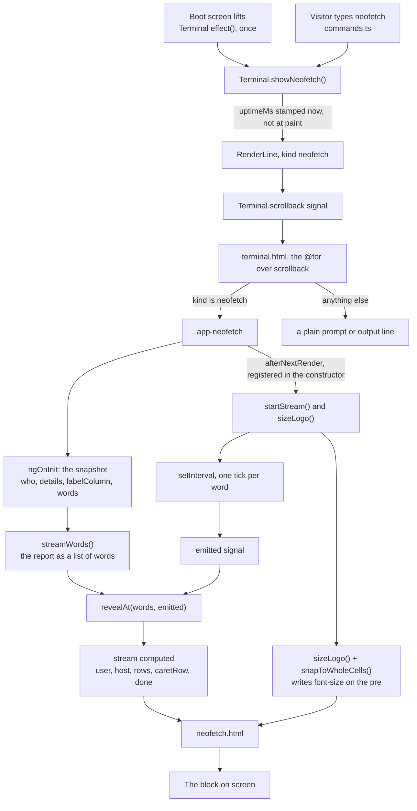
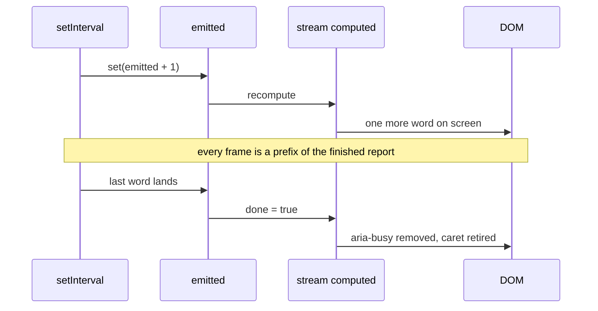

# The `neofetch` block

How the report is produced and rendered: what asks for it, what decides its shape, and
what makes it arrive a word at a time.

The block is the one piece of the terminal that is not a string on screen. Everything else
in the scrollback is text with a prompt in front of it; this is a logo and a two-column
report, so it is a component.

## The pipeline

## What happens on a single tick

The timer touches nothing but the counter. What is on screen is a pure function of the
planned words and how many have landed, which is why a slow frame skips a beat rather than
corrupting a line.

## Two rendering mechanisms, deliberately different

**The text is signal-driven.** `streamWords()` plans the report once, `emitted` counts up,
`revealAt()` projects it. Nothing about the DOM is read.

**The logo is measured.** `sizeLogo()` asks CSS what font size it picked, then writes back the
largest size at or below that whose glyph cell is a whole number of device pixels. It has to
run after render because it needs a real element to measure, and it re-runs on resize and when
the webfont finishes loading, since both change the answer.

They stay separate because they answer to different things: the text answers to the stream
clock, the logo to the viewport.

The logo is not streamed. It is the block's shape, and revealing it gradually would push the
finished lines down the screen as the art grew - the opposite of what output does.

## Why a word, not a character

Two reasons, both practical.

Words vary in length, so a fixed interval still lays characters down at an irregular rate -
which is what streamed output looks like - while the schedule stays deterministic enough to
test.

And the report is a grid, not a string. A label and its value live in different cells, so a
single character has no one place to land, but a word does. A word is the smallest unit that
still has an obvious home.

## The one promise

> What is on screen is always a prefix of the finished report.

Nothing is rewritten, nothing is reordered, no word moves once it has landed. `revealAt()`
holds this as a pure function, and it is asserted both ways: in the unit tests over every
count, and in the browser by sampling a real load and checking each frame against the next.

## Files

Paths are from the repository root. The implementation lives under `src/app/`.

| File                                      | Responsibility                                                        |
| ----------------------------------------- | --------------------------------------------------------------------- |
| `src/app/terminal/line.ts`                | `LineKind` gains `neofetch`; `RenderLine.uptimeMs` carries the stamp  |
| `src/app/terminal/commands.ts`            | the `neofetch` command, and `showNeofetch()` on the context interface |
| `src/app/terminal/terminal.ts`            | `showNeofetch()`, the MOTD effect, `commandCount`, the `theme` input  |
| `src/app/terminal/terminal.html`          | branches the scrollback loop onto `<app-neofetch>`                    |
| `src/app/terminal/terminal.config.ts`     | `reveal.msPerToken`, `font.advanceRatio`, `system.*`                  |
| `src/app/terminal/neofetch/neofetch.ts`   | planning, streaming, measuring: everything above                      |
| `src/app/terminal/neofetch/neofetch.html` | binds the reveal to the DOM                                           |
| `src/app/terminal/neofetch/neofetch.scss` | art sizing, the reserved label column, the cursor                     |

## Settings

| Setting    | Where                      | Value             | What it controls                                   |
| ---------- | -------------------------- | ----------------- | -------------------------------------------------- |
| Cadence    | `config.reveal.msPerToken` | 38                | one word per tick; the report is ~27 words, so ~1s |
| Cell ratio | `config.font.advanceRatio` | 0.6               | JetBrains Mono's advance, 600 units per 1000 upem  |
| Art width  | `neofetch.scss`            | `100vw / 42`      | about three quarters of a phone's text column      |
| Text cap   | `neofetch.scss`            | `--text-terminal` | the art never outgrows the terminal's own text     |

`REVEAL_TIMING` wraps the cadence and `REDUCED_MOTION` the platform preference, as injection
tokens, so tests can drive either without waiting on real time or faking a media query.

## Details that only exist because the text grows

**The label column is reserved.** The grid sizes that column to its content, so left alone it
grows every time a longer label lands - and every value already on screen slides right behind
it. `widestLabel()` measures the finished report, `ngOnInit` turns that into `labelColumn`, and
the template binds it to `--label-column` before the first word is typed.

**The cursor is a pseudo-element.** It marks whichever row is current through
`[class.caret-here]` rather than a child element. An element inserted beside an interpolation
drags template whitespace in with it, and the report would end up holding spaces it never
typed. The colon is markup for the related reason: a `dt::after` would put the cursor between
a label and its colon.

**The cursor retires.** It marks "more is coming". One that outlives the stream reads as a
prompt waiting for input, and this block is output.

## Accessibility

The block carries `aria-busy` while the report is arriving and nothing after, and
deliberately **no live region**: a live region would announce every word as it landed, so a
screen reader would hear "OS", "mpdev", "web", "terminal" as separate utterances instead of
one finished line. With `prefers-reduced-motion: reduce` the whole report is present
immediately - the same information, without the wait.

## Verified

The streaming is checked in the browser, not only in unit tests: sampled from a real page
load at 390px, confirming multiple distinct frames, monotonic row growth, every frame a prefix
of the finished report, the cursor riding the newest word and retiring at completion, the
value column holding one left edge throughout, and `clear` mid-typing leaving no orphaned
timer behind.

## Known seam: the view does not follow the growth

The terminal pins the view to the bottom in an `afterRenderEffect` that reads `scrollback()`,
`input()` and `viewport.height()`. None of those change while a report is typing - `emitted`
belongs to the child view - so the pin runs once when the block is created, against the height
it had at that moment, and never again.

This is new with the stream. Everything else in the scrollback changes height by _appending
an entry_, which is a `scrollback()` change, so the pin re-runs against the new total. The
report is the first thing here that changes size while the list stays exactly as long: before
it typed a word at a time, the block was already complete the moment it was added.

At 390x844 the finished block still fits, so this is invisible. At 390x320 - a phone in
landscape, or one with the keyboard open - it is not:

| measured after the greeting finishes | value                                  |
| ------------------------------------ | -------------------------------------- |
| scroller `scrollTop`                 | 0, i.e. never moved                    |
| content height vs visible height     | 419px vs 266px                         |
| left below the fold                  | 153px                                  |
| live prompt line's bottom            | 457px, against a visible edge at 320px |

So the report types itself in, finishes, and leaves the line you are meant to type on off
screen. Typing still works - the input is captured regardless of scroll position - but the
caret is not visible.

The fix is to make the follow respond to growth rather than to new lines only. A
`ResizeObserver` on the scroller's content is the direct version of that; it also covers
anything else that changes height without touching the scrollback, such as the logo resizing
on rotation.
